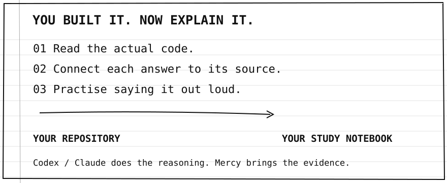
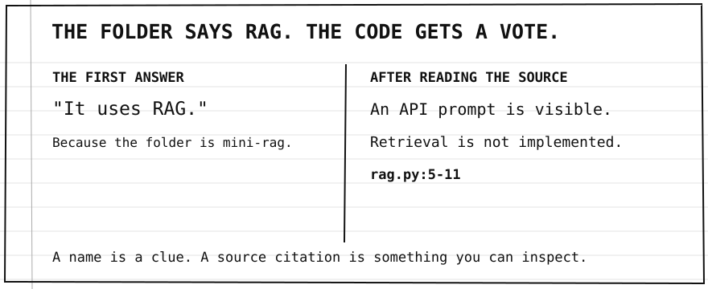

<p align="center">
  
</p>

<h1 align="center">Mercy<br><sub>that one teacher we all know</sub></h1>

<p align="center"><strong>You built it. Now explain it.</strong><br>
A codebase teacher and viva coach inside Codex or Claude Code.</p>

<p align="center">
  <a href="#install">Install plugin</a> · <a href="output-example/mercy-studio.html">Sample notebook file</a> · <a href="#how-it-works">How it works</a> · <a href="docs/ARCHITECTURE.md">Architecture</a>
</p>

<p align="center"><sub>Python 3.10+ · Codex / Claude Code · Offline HTML notebook · MIT</sub></p>

---

You know her. Glasses halfway down her nose. You finish explaining your project. She waits a second.

**“Okay. Show me where that happens in the code.”**

Mercy brings that teacher into your coding agent. She helps you understand the repository, turn source evidence into study notes, and practise defending the project one question at a time.

<p align="center"></p>

## The code gets a vote

<p align="center"></p>

The included [`mini-rag`](examples/mini-rag) example is deliberately misleading. Its [`rag.py`](examples/mini-rag/rag.py#L5-L11) sends a question to an API; it does not implement retrieval. Mercy's job is to make that distinction visible, with citations and explicit unknowns.

## A notebook you can study


Open **Project Overview** to see the frontend, backend, model origins and resource links. Use **Questions** for short spoken answers. Expand **Details** for the full explanation and citations. Follow the user flowchart, then explain the whole-system component diagram. The original marker headings, ink borders and paper background stay, with one violet highlighter accent.

The report is one self-contained HTML file. Its artwork, font and interactions are embedded. Keep the editable evidence JSON and Markdown companion beside it.

## Three ways to call her

**Understand.** “Explain this codebase” generates a reviewed HTML notebook by default. For a focused answer in chat, ask “Walk me through the request handler. What calls the model, and what happens if it fails?” Mercy inspects the relevant source and separates what it can support from what still needs checking.

**Prepare.** “Make a notebook for my project viva.” Mercy builds a starter bank, reviews it against your code, and turns the checked explanations into study material you can edit and regenerate.

**Rehearse.** “Ask me about the architecture, one question at a time.” Answer in your own words. Mercy gives feedback, points back to the source and follows up on the part you missed.

## Inside the notebook

| Page | Use it for |
|---|---|
| **Project Overview** | Locate frontend/backend code and understand model sources with logos and resources. |
| **Questions** | Search, filter and hide answers to rehearse. |
| **Flowchart** | Follow reviewed user actions and decisions. |
| **Architecture** | Explain components and resolved import connections. |
| **Folders** | Expand a nested explorer; read a folder or file explanation beside it. |

**Keep your notes.** `mercy-evidence.json` holds the editable answers and evidence. `mercy render` rebuilds the notebook after your edits; the Markdown companion gives you a plain-text alternative.

## What an evidence-backed answer looks like

> **Question:** Where is retrieval implemented in the mini-rag example?
>
> **Source-supported:** `answer_question` sends the question straight to the chat-completions API in [`rag.py:5–11`](examples/mini-rag/rag.py#L5-L11). This function does not perform retrieval.
>
> **Not verified:** Whether the API call succeeds at runtime. Inspecting source does not execute it.

That is the kind of distinction you need in a viva: a clear explanation, a location you can open, and an honest boundary.

## How it works

**Investigate → review → render → rehearse.**

Your host agent reads bounded source excerpts with `mercy context`, checks and improves the answers, saves complete reviewed questions with `mercy review`, and rebuilds the notebook with `mercy render`. Then it coaches you through a mock viva.

Mercy uses the model already inside **Codex or Claude Code**. The native workflow needs no separate model service or provider key. The host's own privacy and connectivity settings still apply.

For new notebooks, the skill uses a guided loop: ten required project topics, one review task at a time, bounded source excerpts and an exact JSON patch shape. This reduces the amount a smaller model must keep in mind. It detects unfinished or later-edited answers; it cannot guarantee correct reasoning or 100% accurate analysis. See [guided review](docs/GUIDED_REVIEW.md).

## Install

Install the repository marketplace, then the Mercy plugin. Python 3.10+ is required; the evidence toolkit is bundled with the plugin.

**Codex — terminal**

```bash
codex plugin marketplace add Gurtejhundal/Mercy
codex plugin add mercy@mercy
```

Start a new Codex chat. Select **Mercy** from the plugin picker by typing `@`, or invoke its skill explicitly:

```text
$mercy:mercy explain this codebase and help me prepare for my viva
```

Send **@Mercy** by itself to generate or resume the reviewed HTML notebook and receive its actual file link. This also applies after an overview was discussed earlier in the same chat; a prior explanation does not turn the invocation into a mode-selection menu. Explicitly ask for a focused answer or mock viva when that is what you want.

The picker subtitle is **that one teacher we all know**. Picker availability depends on your Codex client; the namespaced skill is the explicit invocation.

**Claude Code — send these as separate prompts**

```text
/plugin marketplace add Gurtejhundal/Mercy
```

```text
/plugin install mercy@mercy
```

Then invoke:

```text
/mercy:mercy explain this codebase and help me prepare for my viva
```

No hooks or provider credentials are installed. The plugin reads source only when you ask it to work. Your host's privacy settings still apply.

Prefer the standalone Python CLI or project-local `$mercy` / `/mercy` skills? The [full technical guide](#full-technical-guide) below preserves that installation path.

## What to ask her

| You say | Mercy helps you do |
|---|---|
| “Explain this codebase.” | Investigate the repository and generate a reviewed HTML study notebook. |
| “Make me a study notebook.” | Prepare questions, review grounded answers and render the HTML. |
| “Where is the model trained?” | Look for evidence and say when training is not demonstrated. |
| “Take my viva.” | Practise one question at a time with feedback tied to the project. |

These are natural-language requests to the native skill, not extra CLI subcommands.

## The toolkit

| Command | Purpose |
|---|---|
| `mercy inspect --project .` | Inspect bounded repository metadata. |
| `mercy context --project . --query "answer_question"` | Read numbered source matches. |
| `mercy prepare --project .` | Create a starter notebook, evidence JSON and Markdown. |
| `mercy prepare --project . --guided` | Seed ten project topics for incremental host review. |
| `mercy next --project . --input mercy-output/mercy-evidence.json` | Get the next guided task, source hints and a complete patch template. |
| `mercy review --project . --input mercy-output/mercy-evidence.json --review review.json` | Validate and merge complete reviewed questions. |
| `mercy render --input mercy-output/mercy-evidence.json` | Rebuild after evidence edits. |

An existing guided notebook resumes with `next`; `prepare --guided` refuses to overwrite existing evidence. `next` reports `ready_to_render` only when all required topics and all current questions have matching review records against the saved source snapshot. A `not_verified` answer can complete a review step with a concrete next check; completion does not mean every feature was verified. Human-edited JSON still renders, and changed answers appear as pending review.

## A few honest answers

**Does it run my application?**

Ordinary analysis reads source. It does not run your application, database or project tests.

**Does the graph prove how requests flow?**

Architecture uses reviewed, cited source relationships when provided, including HTTP connections. Otherwise it labels its resolved-import view. Runtime behavior needs separate evidence.

**Does it invent missing details?**

It should label missing evidence and uncertainty. You still review the answers: a valid citation points to source; it does not guarantee every AI-written sentence is correct.

**Can I use it without opening HTML?**

Yes. Ask focused questions or practise in your agent. Generated reports also include an editable JSON file and a Markdown text companion.

**Where are the full instructions?**

Below. The installation options, evidence workflow, safety boundaries and command reference are preserved.

---

<a id="full-technical-guide"></a>
<details>
<summary><strong>Full technical guide — setup, commands, safety, development and repository layout</strong></summary>

## Start Mercy in this workspace

The Python package now lives at the repository root. Python 3.10+ is enough to run its local tools without installing runtime dependencies:

```bash
python3 -m mercy install --project . --platform both
```

In Codex, invoke **`$mercy explain this codebase and help me prepare for my viva`**. In Claude Code, use **`/mercy explain this codebase and help me prepare for my viva`**. Start a new host session if newly installed skills are not yet discovered.

Mercy has three modes: investigate a focused code question, prepare a reviewed notebook, or coach a mock viva one question at a time. It does not modify your application or run it as part of ordinary analysis. Code excerpts are visible to the host model under that host's privacy settings; “no separate model server” does not mean the host itself runs offline.

### Evidence tools used by the agent

```bash
python3 -m mercy inspect --project examples/mini-rag
python3 -m mercy context --project examples/mini-rag --query "answer_question"
python3 -m mercy context --project examples/mini-rag --path rag.py --start 5
python3 -m mercy prepare --project examples/mini-rag --out mercy-output/example
python3 -m mercy review --project examples/mini-rag --input mercy-output/example/mercy-evidence.json --review mercy-output/example/review.json
python3 -m mercy render --input mercy-output/example/mercy-evidence.json
```

`prepare` creates starter questions from static clues. The host agent supplies the reasoning: inspect source, replace generic answers, add relevant questions, then run `review` and `render`. `context` returns bounded, redacted, numbered text matches. `review` validates complete question records and current source fingerprints, merges existing/new IDs and saves atomically. A review is a JSON object with only a `questions` array using the [question schema](docs/QUESTION_STRATEGY.md). It cannot replace scan metadata.

Preserve existing reviewed notebooks. For a fresh scan after source changes, prepare into a new folder under `mercy-output` and recheck answers before carrying them forward. Older evidence without source fingerprints can still render; refresh it before using the new review command.

## Try the included example

Open `output-example/mercy-studio.html` in any modern desktop browser. The example is deliberately misleading: the folder is named `mini-rag`, but the code does not demonstrate a real retrieval pipeline. Mercy must not claim it uses RAG merely because the project is named that way.

### What you can do in the HTML

| Area | Interaction | What it means |
|---|---|---|
| **Project Overview** | Find frontend/backend paths, model origins, logos and resources | Source analysis, not runtime proof |
| **Questions** | Search, filter and rehearse with answer toggles | Reviewed content, with explicit unknowns |
| **Flowchart** | Follow user steps and named decision branches | Authored from handlers and call sites, not imports |
| **Architecture** | Choose one component and follow its direct dependencies | A → B aggregates resolved imports; fallback groups are heuristic |
| **Folders** | Open folders and files in an explorer with a right-hand explanation pane | The scan may cover only part of the repository |

The responsive notebook keeps the teacher and embedded handwritten font, with a readable sans-serif body and one violet highlighter accent. Ordinary wheel/two-finger trackpad scrolling moves diagrams; Ctrl+wheel and trackpad pinch zoom them. Buttons provide +, − and Fit. No CDN, browser storage or new dependency is required. Project colour sampling remains metadata rather than overriding legible study colours.

Set `overview: true` on key viva records to group their short answers in Project Overview. Include data/model provenance, algorithms, parameters, formulas and code, evaluation, relevant fundamentals, users, idea and output; identify unknowns rather than inventing results. Optional `resources` link to authoritative proof.

Guided submissions use questions of at most 14 words and answers of at most 45 words. Full analysis remains editable under Details. See [the study format](docs/STUDY_FORMAT.md) for overview questions, component connections, user flows and folder descriptions. Structural checks help smaller host models follow the contract; they cannot guarantee 100% accuracy.

## Install and run (Ubuntu/Linux/macOS)

Requires Python 3.10+. From the extracted `Mercy` folder:

```bash
python3 -m venv .venv
source .venv/bin/activate
pip install -e .
mercy prepare --project /path/to/your/repository
```

Open `/path/to/your/repository/mercy-output/mercy-studio.html` **directly in your browser**. The entire page, its graph data, and its functionality are embedded in that single HTML file.

Generated files:

- `mercy-studio.html` — **primary deliverable:** Project Overview, concise overview questions, user flowchart, system architecture and file explorer.
- `mercy-evidence.json` — editable and machine-readable scan evidence + Q&A; source for regeneration.
- `mercy-viva.md` — text alternative with the complete question answers.
- `mercy-architecture.md` — reviewed components with Mermaid-style source connections (resolved imports as fallback).

A legacy PDF is **off by default** and ReportLab is not required for HTML. If you specifically want PDF, first install the optional extra from the Mercy checkout (`pip install -e '.[pdf]'`), then pass `--pdf`:

```bash
mercy prepare --project . --pdf
```

The HTML includes file paths, exported symbols, framework names, routes and question answers. Review it before you share it with anyone, especially if the underlying project is confidential. Source bodies are absent by default. When requested, use `mercy render --input REPORT/mercy-evidence.json --project PROJECT --include-source` to embed redacted indexed code/styles in the file inspector. Source fingerprints must match the saved scan; the read budget is 2 MB, each file is at most 90 KB, and lines are shortened to 160 characters. Data/configuration JSON, model files and datasets are not embedded. Redaction is best-effort; keep private reports private.

## Enable Mercy inside Claude Code and Codex

First ensure the `mercy` CLI is installed and available on your PATH. Then:

```bash
mercy install --project /path/to/repository --platform both
```

- **Claude Code:** invoke `/mercy` inside the target repo.
- **Codex:** invoke `$mercy` inside the target repo.

`@mercy` is **not** a universal skill invocation; different coding agents have different mechanisms. The skills use the host model to investigate source with `mercy context`, apply reviewed answers with `mercy review`, and regenerate the notebook with `mercy render`. A focused question needs no new report.

Optional Claude Code hook, **not needed** for normal usage:

```bash
mercy install --project /path/to/repository --platform both --hooks
```

This adds only a small `SessionStart` reminder hook that must be reviewed/approved in Claude. It does not bypass any agent permission or run scans automatically. There is no Codex hook setup in this version.

## Command reference

```bash
mercy prepare --project .                   # offline HTML + evidence JSON + Markdown
mercy prepare --project . --limit 20        # first 20 core questions
mercy prepare --project . --pyq my-pyq.txt # user-supplied questions, origin not authenticated
mercy prepare --project . --pdf             # optional legacy PDF too
mercy inspect --project .                   # print scan metadata only; no files written
mercy context --project . --query "route handler" # numbered source matches
mercy context --project . --path app.py --start 10 # bounded source excerpt
mercy review --project . --input mercy-output/mercy-evidence.json --review mercy-output/review.json
mercy render --input mercy-output/mercy-evidence.json               # regenerate HTML and Markdown
mercy render --input mercy-output/mercy-evidence.json --project .   # also resample project theme
mercy render --input mercy-output/mercy-evidence.json --pdf         # optionally regenerate PDF
```

For **explicitly approved** API-assisted rewording, `--ai` is supported by the older engine and requires `OPENAI_API_KEY`. The native host skills never invoke this legacy option. The local CLI default does not make requests. Do not enable `--ai` in private or client projects without authorization: even reduced code metadata can be sensitive.

### How design-language adaptation works

Mercy also supports an explicit and safe `mercy-theme.json` in the **analyzed project root**, which stores validated palette hints and legacy design tokens without accepting arbitrary CSS:

```json
{
  "primary": "#3f624b",
  "secondary": "#b4825d",
  "background": "#f8f9f5",
  "panel": "#ffffff",
  "text": "#242d27",
  "muted": "#657066",
  "font": "system",
  "radius": 12
}
```

Allowed colors are 6-digit hex strings; `font` can be `system`, `serif`, or `mono`; `radius` is an integer from 5 to 28. Mercy rejects low-contrast background/text combinations. The current ink notebook keeps a fixed visual style; validated tokens are retained in evidence for compatibility rather than applied to its surfaces. These design tokens are saved in the evidence JSON so `mercy render` preserves them even when you do not pass `--project` again. `examples/galaxy-demo/mercy-theme.json` demonstrates it.


Mercy finds a bounded sample of **literal hex colors** from readable, non-symlink CSS/HTML/Vue/Svelte style files that were already indexed during the scan. It selects an accent palette from non-neutral colors. The notebook keeps a consistent paper-and-highlighter style; sampled colors are retained as palette metadata. This is **palette adaptation, not visual cloning**: typography, component shapes, and contrast protections remain Mercy-specific. See [`docs/DESIGN_SYSTEM.md`](docs/DESIGN_SYSTEM.md) for the detailed rules and limitations.

## Security and fidelity

Mercy does **not** execute imported project code, launch a server, open databases, follow symlinks, read `.env` files, or send repository data to external services by default. The browser page contains no external scripts, networking calls, or localStorage usage. It uses safe DOM text insertion and escapes JSON embedded in HTML to prevent HTML/script-breakout by malicious file names.

- File groups contain only indexed paths; no groups are fabricated.
- File roles are heuristic (path, extension, source code clue), not guaranteed service boundaries.
- Component links aggregate statically resolved imports; they do not prove runtime calls.
- User flowcharts and reviewed architecture connections require cited source traces, separate from import connections.
- Dataset-like files and AI API libraries are **clues**, not proof of training, retrieval, accuracy or inference deployment.
- The scanner is bounded and skips several high-risk/large files; the map may be incomplete.

## Development and tests

```bash
pip install pytest
python3 -m pytest -q
python3 -m unittest discover -s tests -p test_agent.py -v
node --test tests/studio_ui.test.cjs
```

The test suite checks CLI output, HTML safety, file edges, data provenance, theme extraction and skill installation. The browser interaction smoke test uses optional Playwright/Chromium and is documented in `docs/VALIDATION.md`.

## Repository layout

```text
Mercy/
├── mercy/
│   ├── agent.py           # source context, proof validation, atomic answer review
│   ├── scanner.py         # local, bounded code metadata scan
│   ├── questions.py       # plain-language Q&A with evidence and uncertainty
│   ├── studio.py          # atlas payload + color sampling + safe HTML embedding
│   ├── assets/studio.html # offline guide, user flows, components and viva Q&A
│   ├── renderer.py        # evidence JSON, Markdown, optional legacy PDF
│   ├── cli.py             # prepare, inspect, context, review, render, install
│   └── integrations/      # packaged native agent skill files
├── skills/                # source copies of agent instructions
├── hooks/                 # optional reminder hook example
├── docs/                  # concept, architecture, UI/UX, safety, roadmap, tests
├── examples/mini-rag/     # intentionally misleading example
├── output-example/        # generated single-file HTML + JSON + Markdown
└── tests/
```

## Boundaries and next release

This version provides a **native Codex/Claude coaching workflow and an offline study report**. The host model performs reasoning; the CLI provides bounded source access and validated report updates. It is not a runtime architecture verifier or a full AST call graph. Future work: approved runtime traces, deeper automatic frontend/API/backend/storage mapping, AST symbol graphs across more languages, semantic search over code, and project-theme adapters that understand design tokens. Details in [`docs/ROADMAP.md`](docs/ROADMAP.md).

Mercy distinguishes source clues, host reasoning and runtime proof. A citation validates a location, not the truth of every sentence an AI writes.

## Website and notebook artwork

`public/` is a buildless static website. GitHub Pages publishes the `main` branch at `/ (root)`; the root `index.html` opens `public/`, and `.nojekyll` keeps the supplied files intact. `.github/workflows/pages.yml` checks the toolkit and website before you rely on them. It introduces the native coaching workflow and links to `public/demo.html`, a real report generated from `examples/mini-rag`. The report exporter embeds its own font and teacher image; report files do not depend on website assets or a CDN.

The teacher drawing was supplied by the project owner. Patrick Hand by Patrick Wagesreiter is included under the SIL Open Font License; see `mercy/assets/OFL.txt` and `public/assets/OFL.txt`.

On native skill invocation Mercy starts with **“Mercy — that one teacher we all know”**. Human-readable CLI commands display the same line; `inspect` and `context` keep clean JSON output for tool callers.

</details>

## License

[MIT](LICENSE). Teacher artwork supplied by the project owner; bundled font license: [SIL OFL](mercy/assets/OFL.txt).
