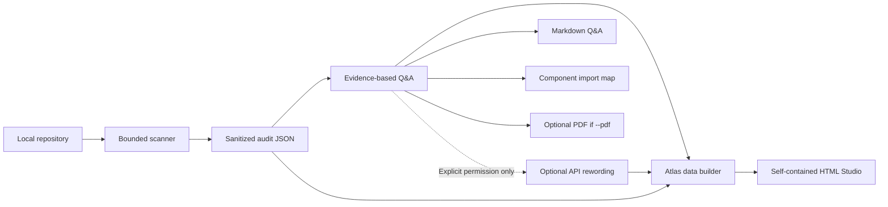

# Mercy — native host-agent architecture

## Agent execution model

Codex or Claude Code is the model and orchestrator. Mercy does not start a model, host a chat service or require a provider key. The host receives source excerpts under its own privacy policy; local CLI tools and the generated notebook make no network requests by default.

1. Native `mercy` skill identifies the user's focus: investigate, prepare a notebook or rehearse a viva.
2. `inspect` finds bounded metadata; `context` supplies numbered, redacted source excerpts.
3. The host reasons over real source, distinguishing inferred behavior from static evidence.
4. For notebooks, `review` validates a complete question patch, checks source inventory/fingerprints and atomically merges it into the evidence JSON. Invalid/stale patches leave the file unchanged.
5. `render` regenerates the offline Project Overview and companions. During a mock viva the host asks one question at a time and adapts to the learner.

`prepare` is a deterministic seed generator, not AI reasoning. Its source hashes make later review detect same-length edits. Older reports still render but require a fresh scan before review. Existing reviewed answers are retained unless their IDs are explicitly replaced.

For new host notebooks, `prepare --guided` seeds ten required project topics and top-level workflow bookkeeping. `next` verifies the bounded source snapshot, returns one pending question with bounded excerpts and a complete patch shape, and reports remaining work. `review` records content digests only after validation; manual edits make those questions pending again. `render` preserves this bookkeeping and keeps submitted review progress under About this report without blocking human edits. Completion measures submitted records, not semantic correctness. See `GUIDED_REVIEW.md`.

## Analysis and export pipeline



## Core modules

- `mercy/agent.py`: bounded redacted source context, shared proof-schema validation, current-source checks, and atomic review updates.
- `mercy/scanner.py`: discover bounded, local regular files; skip symlinks, secret-prone names and dependency directories; parse Python AST for imports/symbols, detect supported routes and tech clues conservatively; export normalized `files`, `edges`, `signals`, `frameworks`, `datasets` and warnings.
- `mercy/questions.py`: make the question bank with compact viva answers, fifth-grade explanations, `status`, `verify_next` and `file:line` citations. Optional user-provided question list is not certified as real PYQs.
- `mercy/studio.py`: classify indexed files into heuristic roles, produce only populated clusters, preserve actual scanner import edges, sample CSS accent colors safely, serialize atlas JSON into an inert `application/json` script tag.
- `mercy/assets/studio.html`: self-contained CSS + JS; Project Overview, concise question cards, source-traced demo/user flowcharts, component import diagram and nested folder/file explorer. No external assets/network/browser storage.
- `mercy/renderer.py`: JSON, Markdown, legacy optional PDF and static Mermaid architecture clues.
- `mercy/llm.py`: optional external answer-language rewrite using a reduced metadata digest; invoked only with explicit `--ai`.
- `mercy/cli.py`: `prepare`, `inspect`, `context`, `next`, `review`, `render`, `install`. `prepare` writes HTML by default; `--pdf` adds the old PDF, not a replacement.
- `mercy/integrations/`: installed native skills for Claude/Codex, and optional approved Claude reminder hook.

## Atlas data contract

`studio.py` generates an embedded object:

```json
{
  "format_version": 3,
  "project": "repo-name",
  "summary": {"read_files": 8, "module_links": 2},
  "theme": {"primary": "#40dbe6", "source_type": "Mercy-fallback"},
  "clusters": [{"id": "backend", "name": "Backend", "files": ["app.py"], "proof": "heuristic grouping from names and file types"}],
  "files": [{"path": "app.py", "role": "backend", "lines": 52, "routes": [], "symbols": [], "kind": "file"}],
  "edges": [{"source": "app.py", "target": "helper.py", "via": "helper", "line": 1, "kind": "import", "certainty": "static-reference"}],
  "questions": [],
  "routes": [],
  "glossary": [],
  "warnings": []
}
```

The above is **schema illustration only**, not a claim about any specific repository. Browser graph code reads this object and does not fetch code files.

## Honest visual topology

Architecture nodes are reviewed components whose membership is validated against indexed files. Their arrows aggregate only actual resolved imports between member files. If reviewed components are absent, name/type-based role groups are explicitly labelled suggested; they are not verified service tiers.

User flowcharts are separate reviewed records with cited actions, start/end nodes, decision diamonds and named branches. They are traced from source handlers and call sites, not inferred from import chains. Demonstrations describe user actions and expected source outcomes, not recorded runs. Missing flows or demos are left empty with a specific next step. See `STUDY_FORMAT.md`.

## Offline HTML security

The report exporter escapes `<`, `>`, `&` and Unicode separator sequences in JSON before embedding them in a JSON script element. The web template only reads it via `JSON.parse(textContent)` and builds labels with `textContent` / `createElement` / `createElementNS`; never untrusted `innerHTML`. It contains **no** network calls, external modules, `eval`, service workers, frames, or localStorage. Content still exposes repository metadata and should be reviewed before sharing.

## Evidence and edit loop

`mercy prepare` outputs `mercy-evidence.json`, `mercy-studio.html`, `mercy-viva.md`, `mercy-architecture.md`. The source of truth for answer wording is evidence JSON. A coding agent can inspect actual project code, update verified answers while retaining accurate citations, and call `mercy render --input ...`. Rendering validates question schema and citation path/line against the original scan. Passing `--project` during render additionally re-samples safe project palette hints; the other paths are not re-scanned. If project source changed, rerun `prepare` for fresh evidence.

## Install and permissions

`mercy install --platform both` writes only native skill metadata at `.claude/skills/mercy/SKILL.md` and `.agents/skills/mercy/SKILL.md`, plus Codex metadata; it leaves pre-existing ones unchanged unless `--force`. `--hooks` adds an optional local Claude `SessionStart` reminder that the host must approve. Installing skills does not run a scan, apply repo edits or bypass permissions.

## Known limitations

- Python AST imports and regex-based TS/JS/other parser coverage are not full language parsers.
- Alias resolution, dynamic imports, package exports and generated routes may be missed.
- No framework-specific runtime trace, HTTP execution, or database connectivity tests.
- Reviewed components are capped at 12 per record and user flows at 20 nodes; complex projects need focused workflows. Automatic fallback role groups can differ from actual responsibilities.
- Theme adaptation reads literal CSS colors only, not computed CSS variables or full UI design tokens.
- Host-model reasoning is not automatically verified by citation bounds. Source hashes reject stale input, not semantic mistakes in an answer.


Version 3 includes reviewed components, aggregated import connections, source-traced flows, demo steps, directory/file explanations and a technology/model-source overview. These are validated in `mercy/presentation.py`; authoring fields are documented in `STUDY_FORMAT.md`. Guided review requires bounded `viva_question` and `viva_answer` fields. Old evidence still renders.
