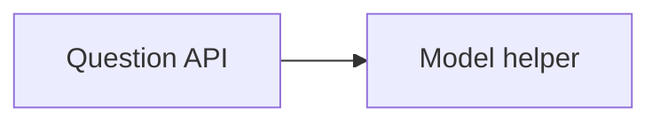

# Architecture: mini-rag

> Source analysis, not runtime proof. Reviewed relationships take precedence over import-only connections.

## Question API

Accepts questions and returns JSON.

Source: app.py:9

## Model helper

Sends a prompt to OpenAI and extracts the answer.

Source: rag.py:5

- `app.py:2` imports `rag.py`
