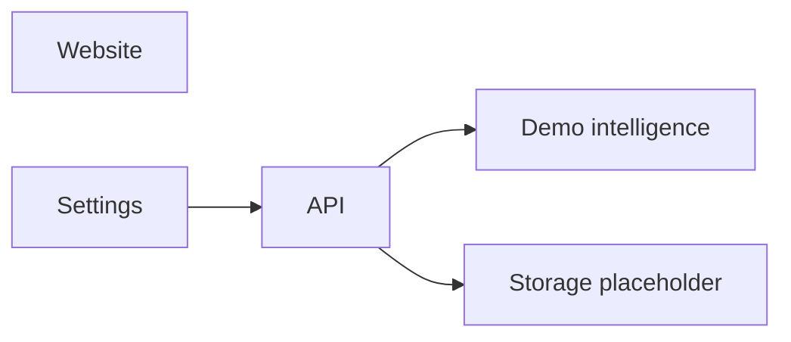

# Architecture: galaxy-demo

> Source analysis, not runtime proof. Reviewed relationships take precedence over import-only connections.

## Website

Displays a heading and demo badge.

Source: ui/components/App.jsx:1

## API

Returns the status JSON.

Source: server/main.py:6

## Demo intelligence

Returns a placeholder vector, not a model prediction.

Source: intelligence/pipeline.py:3

## Storage placeholder

Returns zero without a database.

Source: storage/db.py:1

## Settings

Imports the API application and marks the example as a demo.

Source: infra/settings.py:1

- `infra/settings.py:1` imports `server/main.py`
- `server/main.py:2` imports `intelligence/pipeline.py`
- `server/main.py:3` imports `storage/db.py`
