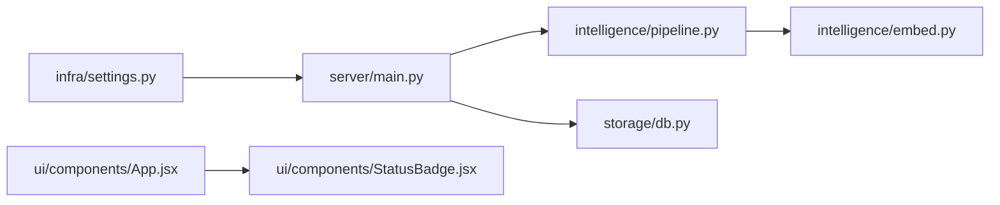

# Mercy architecture clues: galaxy-demo

> **Caution:** imports are dependency clues, not verified runtime data flow.

## Local module imports

## Detected routes

| Endpoint | Source |
|---|---|
| `/status` | `server/main.py:6` |

## Technology hints

| Tech | Evidence |
|---|---|
| FastAPI | server/main.py:1, server/main.py:4 |

## Dataset and model provenance

- No local dataset file confirmed.
- Training steps found: 0 (code markers; not proof of a completed run).
- AI API markers found: 0.
- Retrieval markers found: 0 (not a complete RAG proof).

## What to trace manually

1. One user action and the actual frontend call.
2. The exact API handler and its input/output schema.
3. The database query or model call, if any.
4. What happens on failure and how errors reach the user.
5. Training evidence: data provenance, experiment logs, model weights, and evaluation metrics (if the project trains a model).
